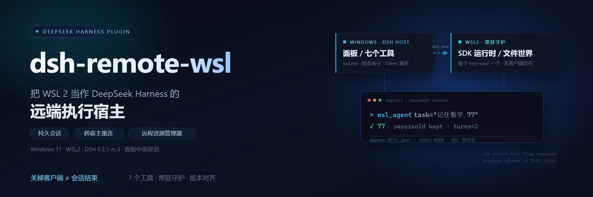
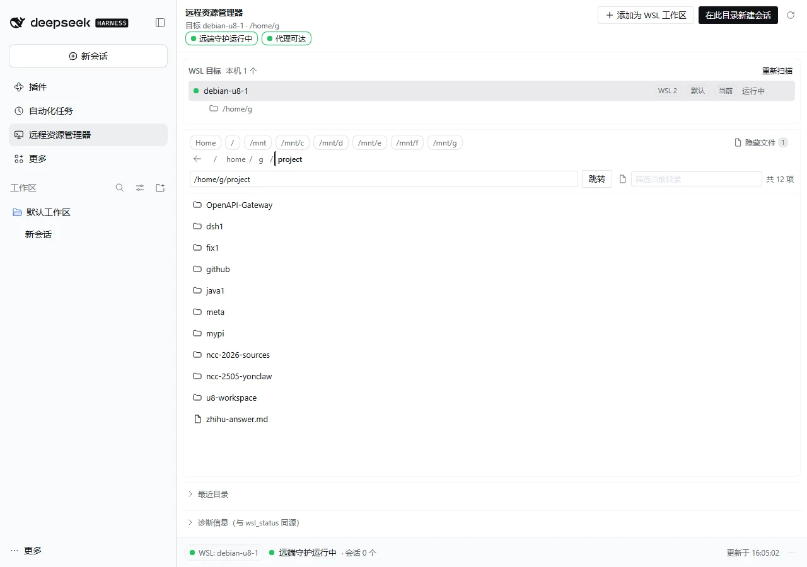
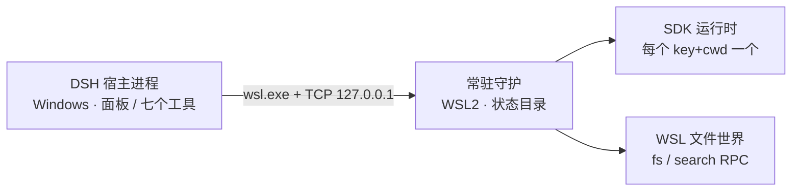
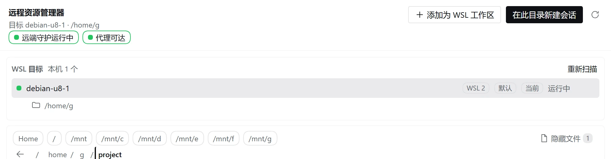
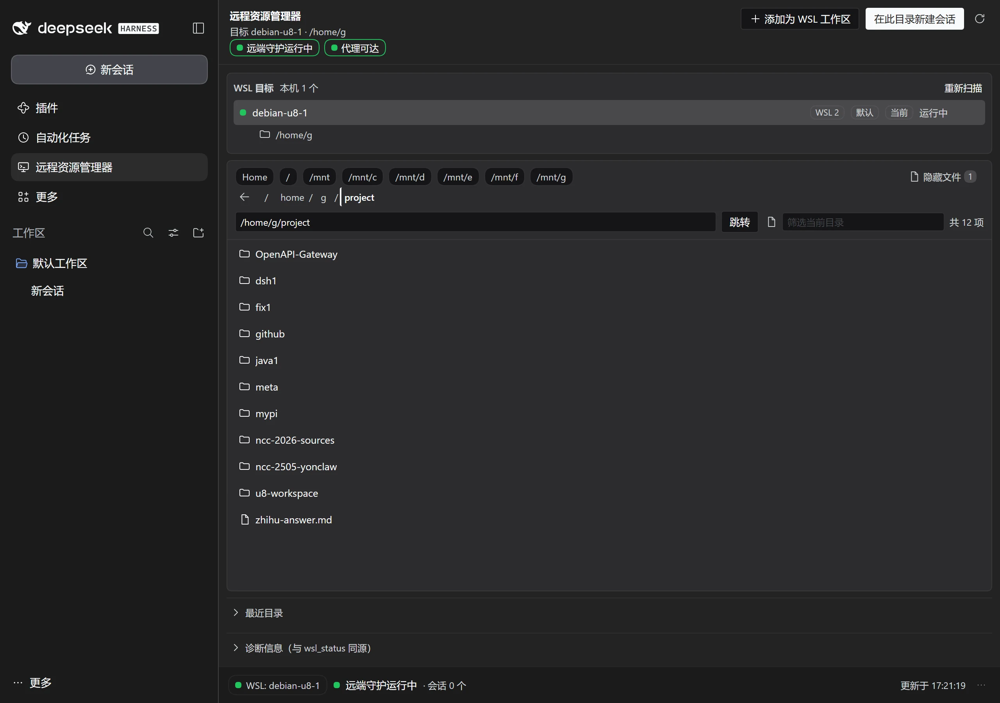
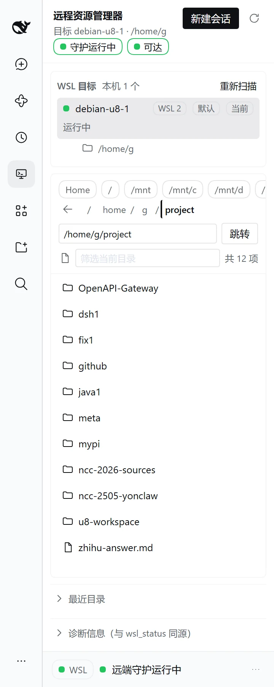

# dsh-remote-wsl



> 把 WSL 2 发行版当作 DeepSeek Harness 的**远端执行宿主**。
>
> 常驻守护让「关掉客户端 ≠ 会话结束」；换一个宿主进程，用同一个 `key` 还能接上之前的上下文。

[](LICENSE)
[](https://github.com/mozhuanzuojing/dsh-remote-wsl)
[](https://github.com/mozhuanzuojing/dsh-remote-wsl)
[](https://github.com/mozhuanzuojing/dsh-remote-wsl)

当前版本 **0.1.0** · 开发依据 DSH **0.2.1-rc.3** · Windows 11 + WSL2 实测 | 面板中英双语 | 只支持 WSL2 | 未发布 npm，按 `link:` 装进 profile



**它是什么**：DSH 桌面壳的 host 由本机启动，没有「连远端 host」的开关（实测与机制见 [docs/2026-10-10-wsl-dsh-sdk-bridge.md](docs/2026-10-10-wsl-dsh-sdk-bridge.md)）。这个插件不假装有——它从 Windows 宿主侧驱动 WSL 里那份 dsh，提供七个工具、一个「远程资源管理器」面板，以及一个把文件工具搬进 WSL 的 agent preset，并把会话持久性、版本一致性和关停边界一起管起来。

## 30 秒上手

1. **装**：profile 的 `package.json` 用 `link:` 加依赖，再把 `dsh-remote-wsl` 加进 `dsh.profile.bundles`（完整步骤见[安装](#安装)）。
2. **验**：重启 DSH 后先调 `wsl_status`——只读、廉价，会报发行版、桌面版本、WSL pin、漂移和守护状态。
3. **用**：`wsl_exec` 跑一次性命令；`wsl_agent` 把任务交给 WSL 里常驻的 dsh（**关客户端 ≠ 会话结束**）。
4. **收**：`wsl_daemon action=stop` 显式结束；不显式停则由 `daemonIdleMs`（默认 30 分钟）回收 ⇒ 上下文丢失。

```text
# 第一个宿主进程（在 DSH 里说）
调 wsl_agent，key=rc1，task="记住数字 77，只回 ACK"

# 完全退出 DSH Desktop，再重新打开（新的宿主进程）
调 wsl_agent，key=rc1，task="刚才让你记的数字？只回数字"
# ⇒ 77 · 同一 sessionId / runtimePid · turns=2
```

前置（简版）：WSL2 发行版，WSL 侧有 `mise` + `pnpm` + Node ≥ 26.10；凭据用 WSL 自己的 `~/.dsh/.credentials.yaml`，**不要复制 Windows 的 key**。完整清单见[前置条件](#前置条件)。

## 它怎么工作



- 默认 `daemon` 后端下，守护的元数据、token 与运行日志都在 WSL 侧（preset 注册诊断 `startup.log` 在 Windows 侧）；Windows 侧不持有 agent 运行时，只发短命命令、按 token 握手，或为 `wsl_open_ui` 挂一个 web host。
- 运行时由守护持有，所以宿主进程退出不会带走会话。
- 版本 pin 在 WSL 侧；桌面升级后用 `wsl_sync_version` 显式对齐。

## 功能

- **常驻会话**：`wsl_agent` 的运行时由 WSL 侧守护持有。关掉 DSH 客户端，会话不会结束；再开一个宿主进程，用同一个 `key` 和同一个 `cwd` 还能接上之前的上下文。回复会带 `sessionId` / `runtimePid` / `turns`。
- **会话结束只有三种方式**：显式 `wsl_daemon action=stop`（`restart` 也会先结束）；空闲 `daemonIdleMs`（默认 30 分钟）回收；守护或运行时死亡。守护在无 key 且无客户端持续 `daemonLingerMs`（默认 10 分钟）后自退，有会话时不会触发。
- **同 key 串行**：并发 prompt 在守护里 FIFO；超过 `daemonQueueLimit`（默认 4）明确拒绝，不静默排队——上游 SDK 没有 cancel。
- **七个工具**：诊断、一次性命令、常驻 agent、守护生命周期、远程 UI、版本对齐、路径互转，详见下方表格。
- **远程资源管理器**：左侧栏「插件」下的面板。
  - **WSL 目标**：发行版列表（状态点 + 默认/当前徽标 + WSL 版本），点行内「切换」换目标；切换只影响本面板的请求，不改插件配置。WSL1 行标「仅支持 WSL2」，面板的 host 方法会拒绝。
  - **目录浏览**：路径框 / 面包屑 / Home / 最近目录，支持隐藏文件与筛选。
  - **守护状态**：头部药丸显示运行态，悬停提示里带 pid/版本/槽位；未运行时可直接点起。底栏显示会话数、更新时间和漂移。
  - **代理三态徽标**：可达 / 不可达（带 `host:port`）/ 未探测。数据取自既有 `snapshot.proxy`，不新增请求。
  - **在此目录新建会话**：浏览到配置 `cwd` 以外的目录时，主按钮是它——建一个真 DSH 会话（cwd 是该 WSL 路径的 UNC，会话出现在左侧列表）；在配置 `cwd` 内主按钮是「添加为 WSL 工作区」。
  - **添加为 WSL 工作区**：把目录登记成 UNC 工作区（该工作区的文件工具走 9P，和「远端会话」是两条路，见下方「已知边界」）。
  - **远端会话卡**：列出 `cwd + sessionId 前 8 位`、轮次与空闲时间，可复制完整 sessionId。
  - **窄态与双语**：320 / 360 / 376 / 416 / 420 / 480 / 1280 七档实测无横向溢出；窄态下快捷目录 chips 保持完整并横向滚动（不压字）；中文 / English 跟随宿主语言。
- **WSL 执行世界（实验）**：agent preset `wsl`，名称「WSL（远程执行世界）」。
  - 文件工具经 `{op:'fs'}` RPC 交给 WSL 侧守护用原生 `node:fs` 执行，**不走 9P**（绕开 `write` 在 `\\wsl.localhost\…` 上的原子写失败）。
  - WSL 内 `grep` / `glob` 优先用 ripgrep / fd，没有再回落 ugrep / GNU grep / find。
  - 18 个常用 Rust CLI（ripgrep、fd、ast-grep、sd、bat、tokei 等）的安装目录：核心 8 个在守护启动时后台预热，`grep` / `glob` 缺 rg / fd 时按需装，任意项可用 `wsl_tools action=install` 装到 `~/.local/bin`。
  - 文件工具按 host 的 `workspace-write` 策略做真实路径围栏（越界返回 `FS_SANDBOX_DENIED`）；`watch` 是 500ms 轮询近似，不做跨 OS 文件事件。
- **版本对齐**：桌面版本从 `primary-runtime/runtime.json` 读；WSL pin 落 `~/.dsh/.desktop-version-pin`。`wsl_status` 报漂移，`wsl_sync_version` 修复，`backgroundWarm` 负责后台预热。守护不会因版本不一致被自动杀掉——要换版本走显式 `wsl_daemon action=restart`。
- **路径互转**：`wsl_path` 只做字符串转换，不创建目录、不改文件；路径走 argv 位置参数，含空格/引号/`$(...)` 也保持字面量。
- **主题**：跟随 DSH 的浅色 / 深色（面板只读宿主 CSS 变量，不写死颜色）。

### 界面



深色（跟随 DSH 主题）：



窄态（窗口 360；快捷目录 chips 横向滚动，完整显示、不再压字）：



### 七个工具

| 工具 | 做什么 |
|---|---|
| `wsl_status` | 只读诊断：发行版、桌面 dsh 版本、WSL pin、漂移、dlx 已装版本、shell 环境开关、`localhostForwarding`、守护 pid/端口/版本/keys |
| `wsl_exec` | 在 WSL 里跑一次性 bash（cwd 是 Linux 路径），回 exit/stdout/stderr；默认 120s，脚本带 `set -uo pipefail`（管道读端早退时 SIGPIPE 会如实表现为 `exit 141`） |
| `wsl_agent` | 把任务交给 WSL 里的 dsh（`--profile sdk`，stdio JSON-RPC）；守护持有运行时，支持 `followUps`、`key`、`cwd` |
| `wsl_daemon` | `status` / `start`（幂等）/ `stop`（显式结束会话，`all=true` 清孤儿）/ `restart`（对齐新版本） |
| `wsl_open_ui` | 在 WSL 里起 `dsh web`，在 Windows 开应用窗口；`stop=true` 停掉 |
| `wsl_sync_version` | 读桌面版本 → 比对 WSL pin → 可选预热 → 修复 pin；`warm=true` 物化该版本 |
| `wsl_path` | 包一层发行版的 `wslpath`：`D:\...` ⇄ `/mnt/d/...`；`direction` 可选 `to-wsl` / `to-windows` / `both` |

## 安装

### 前置条件

- **Windows 10/11 + WSL2**。WSL1 不支持：目标行会标灰，面板的 host 方法会拒绝（7 个工具本身不做 WSL1 检查）。
- **WSL 侧 `mise` + `pnpm` + Node ≥ 26.10**。插件用 `mise exec -- pnpm dlx @deepseek-ai/dsh@<pin> --profile sdk` 拉取对应版本（实际还带 `--allow-build=...`），不要求全局装 `dsh`；首次需要网络/代理。
- **推荐启用 systemd**：`/etc/wsl.conf` 里 `[boot] systemd=true`。systemd 主路径无窗口、且守护独立于 Windows 侧；不可用时走兼容回退，可能弹出可见控制台窗口（插件会在返回值/`notes` 里告警）。
- **WSL 侧凭据**：`~/.dsh/.credentials.yaml`。WSL 与 Windows 是两份独立的 `~/.dsh`，**不要复制任何 key**。
- 代理：`proxyPort` 默认 `9910`。插件先探测再使用；不用代理也可以，探测失败只会显示「不可达 / 未探测」，不阻断直连。

### 装进 profile

仓库必须放在 **Windows 能访问的路径**（host 半在 Windows 跑，WSL 侧会经 `/mnt/<盘符>` 读同一份源码）：

```powershell
git clone https://github.com/mozhuanzuojing/dsh-remote-wsl.git D:\tools\dsh-remote-wsl
```

在 `%USERPROFILE%\.dsh\profiles\<profile>\package.json` 里改两处（**保留原有条目**）：

```json
"dsh-remote-wsl": "link:D:/tools/dsh-remote-wsl"
```

```json
"dsh-remote-wsl"
```

第一处加进 `dependencies`；第二处追加到 `dsh.profile.bundles` 末尾。以本机 `desktop` profile 为例，形如：

```json
{
  "dependencies": {
    "dsh-remote-wsl": "link:D:/tools/dsh-remote-wsl"
  },
  "dsh": {
    "profile": {
      "bundles": ["@deepseek-ai/dsh-base", "@deepseek-ai/dsh-web-app", "dsh-remote-wsl"]
    }
  }
}
```

> 实际使用时应保留你 profile 里已有的 base / web-app 等 bundle，不要只留这三项。`link:` 依赖不会把本包复制进 profile；若 `node_modules` 里还没有同名链接，补一个 junction：

```powershell
$repo = 'D:\tools\dsh-remote-wsl'
$link = "$env:USERPROFILE\.dsh\profiles\desktop\node_modules\dsh-remote-wsl"
if (-not (Test-Path $link)) {
  New-Item -ItemType Junction -Path $link -Target $repo | Out-Null
}
```

重启 DSH Desktop，然后新开一个会话，让 agent 调一次 `wsl_status`；能返回发行版 / 版本 / 守护状态就说明插件已加载。左侧栏「插件」下应出现「远程资源管理器」。

> 不要用 `dsh --profile desktop --dump-config` 验证：`desktop` profile 由 Electron 应用独占，CLI 会直接拒绝（`profile "desktop" is managed exclusively by the Electron application`）。如果面板没出现：先确认上面的 junction 存在，再重启一次（host 半改动一定要重启，client chunk 才是刷新页面即可），并检查 DSH 启动日志里的插件加载错误。

### 配置

默认值 `distro: debian-u8-1`、`wslHome: /home/g` 是作者机器上的值，**必须改成你自己的**：

```powershell
wsl -l -q
$distro = 'Ubuntu-24.04'   # 换成 wsl -l -q 里的名字
wsl -d $distro --exec bash -lc 'echo $HOME'
```

在 `%USERPROFILE%\.dsh\profiles\desktop\cordis.patch.yml` 里覆盖（保留该文件已有内容）：

```yaml
- id: remote-wsl
  config:
    distro: Ubuntu-24.04   # wsl -l -q 里的名字
    wslHome: /home/you     # 发行版里的 $HOME
    cwd: /home/you
    dshVersion: ''         # 空 = 跟随桌面版本
```

常用配置键：

| 键 | 默认 | 作用 |
|---|---|---|
| `distro` / `wslHome` / `cwd` | `debian-u8-1` / `/home/g` / `/home/g` | 目标发行版、WSL 家目录、远端 agent 的默认工作目录 |
| `backend` | `daemon` | `daemon` = 运行时由 WSL 常驻守护持有；`in-host` = 旧形态逃生舱（关客户端即丢会话） |
| `daemonPort` | `8731` | 守护槽位/端口；WSL 侧被占则 +1，Windows 侧被占则换端口重试 |
| `daemonIdleMs` | `1800000` | 空闲回收，到期即丢上下文 |
| `daemonLingerMs` | `600000` | 无 key 且无客户端时的自退闸门；有会话不触发 |
| `daemonQueueLimit` | `4` | 同 key 并发 prompt 的等待位上限，超出明确拒绝 |
| `useShellEnvironment` | `true` | 把 WSL 登录 shell 环境注入 `wsl_open_ui` / `in-host` 运行时；一次性 `wsl_exec` 不注入。默认 `daemon` 后端的 `wsl_agent` 目前恒注入（该开关尚未接到守护启动参数） |
| `backgroundWarm` | `true` | 版本漂移时后台预热，不阻塞当前调用 |
| `webPort` | `3082` | `wsl_open_ui` 在 WSL 里起的 web 端口 |
| `proxyPort` | `9910` | 宿主代理探测端口 |
| `dshVersion` | `''` | 空 = 跟随桌面；也可钉死某个版本 |

## 使用

| 想做什么 | 怎么做 |
|---|---|
| 看发行版 / 版本 / 漂移 / 守护 | `wsl_status` |
| 跑一条一次性命令 | `wsl_exec`（`command`、`cwd`、`timeoutSec`） |
| 让 WSL 里的 agent 做多轮 | `wsl_agent`（`task`、`followUps`、`key`、`cwd`） |
| 关掉客户端后继续 | 同上；重新打开后保持 `key` 与 `cwd` |
| 结束远端会话 | `wsl_daemon action=stop`（或 `restart` 换版本） |
| 打开 WSL 里的 Web UI | `wsl_open_ui`（`port` 默认 3082，`open=false` 只起服务） |
| 桌面升级后对齐版本 | `wsl_sync_version`（可 `warm=true`）→ `wsl_daemon action=restart` |
| Windows / WSL 路径互转 | `wsl_path`（`direction=both` 默认） |
| 浏览 / 打开 WSL 目录 | 左侧栏「远程资源管理器」 |

这些工具是给模型用的：你直接在会话里描述任务，或显式点名工具；下面的例子是显式写法。

### 持久任务

```text
调 wsl_agent，key=release，task="检查 /home/you/project 的构建，失败就修到通过"
```

关闭客户端不会结束它。下次在同一个 profile / 同一份 daemon 配置下（同一个 `daemonPort`），用同一个 `key=release` 和同一个 `cwd` 继续；换了 `cwd` 会开新会话（守护按 `key+cwd` 分运行时）。要立刻结束用 `wsl_daemon action=stop`。

### 一次性命令

```text
调 wsl_exec，command="git -C /home/you/project status --porcelain"
```

超时默认 120 秒；脚本按 `set -uo pipefail` 执行。管道读端早退（如 `yes | head -1`）得到 `exit 141` 是 bash 语义，不是插件失败。

### 远程 UI

```text
调 wsl_open_ui，port=3082
```

它在 WSL 里起 `dsh web`，并用带 token 的 URL 开一个 Windows 应用窗口。桌面壳本身仍然不能连远端 host，这是补位而不是等价替换。

### WSL 执行世界

新建会话时把 preset 选成「WSL（远程执行世界）」，文件工具就落到配置的发行版里；`wsl_tools` 可以列/装这些 WSL 侧 CLI 工具。想跑 WSL 里的命令或一次性体检，仍用 `wsl_exec` / `wsl_agent`。

## 数据存在哪里

- **Windows 侧配置**：`%USERPROFILE%\.dsh\profiles\<profile>\package.json` 与 `cordis.patch.yml`。
- **Windows 侧诊断**：`%USERPROFILE%\.dsh\remote-wsl\startup.log`（preset 注册 / 启动诊断，宿主侧写入）。
- **WSL 侧状态目录**：`$wslHome/.dsh/remote-wsl/`
  - `daemon.<slot>.json` / `daemon.<slot>.token`（0600，按槽位分文件）
  - `daemon.log`、`launch-stderr.log`、`launch.<slot>.sh`（一次性启动脚本，正常启动后清理）
- **面板最近目录**：浏览器 `localStorage['dsh-remote-wsl.recent']`（按发行版分组，最多 8 条）。
- **WSL 版本 pin**：`$wslHome/.dsh/.desktop-version-pin`。
- **凭据**：WSL 的 `~/.dsh/.credentials.yaml`。Windows 的 `%USERPROFILE%\.dsh` 与它是两份独立副本，**不要跨侧复制**。
- `wsl_open_ui` 的 access token 由工具回复返回；不要把它写进仓库或公开日志。

## 兼容性

- **DSH**：在本机 **0.2.1-rc.3** 上实测；`package.json` 声明 `0.2.0-rc.2` / `0.2.1-rc.3` 为 `compatible`。该字段是声明性的，宿主不校验；没实测过的版本不写。
- **平台**：Windows + WSL2；macOS / Linux 不适用，WSL1 不支持。
- **WSL 侧运行时**：Node ≥ 26.10（实测 26.10.0）、pnpm（实测 12.6.0）、mise（实测 2026.9.7）。Windows 侧使用 DSH 自带运行时。
- **systemd**：推荐启用；不启用时走兼容回退，可能弹出可见控制台窗口。
- **面板**：中文 / English 跟随宿主语言；320–1280 七档无横向溢出。
- **分发**：`private: true`，未发布 npm；按 `link:` 装进 profile。

## 已知边界（不假装有）

- **没有命令沙箱**：`wsl_exec` / `wsl_agent` 的命令跑在**你自己的 WSL** 里，不受 Windows 侧 DSH 文件策略约束。要隔离请用 WSL 侧手段。
- **桌面壳不能连远端 host**：`wsl_open_ui` 是补位，不是把桌面壳改成远端连接。
- **SDK 没有 cancel、没有 per-prompt 结果**：放弃一轮 = 结束运行时 = 丢上下文；同 key 并发只能 FIFO + 上限拒绝。
- **9P / UNC 只适合读**：用 Windows 的 `git` / `pnpm` 等写型工具改 WSL 里的 ext4 文件，可能写坏属主/权限；跑工具或改文件请走 `wsl_exec` / `wsl_agent`，或用 WSL 执行世界的文件工具。跨 OS 文件事件不可靠，插件不监听。
- **WSL 执行世界只服务配置的一个发行版**；面板可以浏览多个发行版，但文件世界不会跟着切。
- **`watch` 是 500ms 轮询**，不是 inotify。
- **自动装工具依赖网络**：从 GitHub Releases 选包，限流时走固定地址兜底；失败会把原因和手动安装命令附在结果里，不静默降级。
- **版本兼容是声明的**：`dsh.compatibility.dshReleases` 不会让宿主做任何检查。

## 和同类 WSL 插件怎么选

- 要**一次性命令 / 发行版体检 / 侧栏终端**，`dsh-wsl-tool` 一类更直接；要**关客户端不丢的持久会话 + 跨宿主重连**，用本插件。两套名字不冲突（本插件是 `snake_case`），可以并存。
- `dsh-wsl-workspace` / `dsh-plugin-wsl-env` 把 WSL 当**工作区 / 执行环境**；本插件把 WSL 当**远端运行时宿主**。路线互补，不是替代。
- 路径转换两边都有：本插件是 `wsl_path`，`dsh-wsl-tool` 是 `wsl-path`。

## 开发

零构建 TypeScript（Node 原生 type stripping），没有 `@deepseek-ai/*` 运行时依赖；`client/` 是零构建 chunk，CSS 也在入口里。Windows 侧用 DSH 自带的 Node 即可跑 `.ts`（实测 24.21.0）；WSL 侧守护按 `engines.node` 需要 ≥ 26.10。

| 路径 | 作用 |
|---|---|
| `src/index.ts` | 插件入口：默认配置、注册七个工具 / 面板数据面 / preset |
| `src/register-tools.ts` | 七个工具的实现 |
| `src/daemon.ts`、`src/daemon-*.ts` | WSL 侧常驻守护、协议、launcher 与生命周期 |
| `src/explorer.ts` | 面板数据面 `POST /remote-wsl/api`（同源 + 硬白名单） |
| `src/fs-provider.ts`、`src/fs-rpc.ts` | WSL 执行世界的 fs provider 与 RPC |
| `src/preset.ts`、`src/search-tool.ts` | `wsl` preset、WSL 内 `grep` / `glob` 与 `wsl_tools` |
| `client/` | client 半 chunk（含 i18n 与全部 CSS） |
| `assets/` | README 配图：banner、宽态 / 深色 / 窄态 / 头部截图 |
| `docs/` | 契约、设计、评审与先例调研 |
| `spike/verify/` | 每轮探针、原始输出与报告 |

常用命令：

```powershell
# DSH 自带 Node（默认安装位置；自定义安装请改路径）
$node = "$env:LOCALAPPDATA\Programs\DeepSeek Harness\resources\runtime\primary-runtime\dependencies\node\bin\node.exe"

# 守护链路自检（status 不会启动守护；未运行时以非 0 退出是正常的）
& $node src/selftest.ts status

# 跨进程重连：每次 prompt 都是新进程，同一个 key 仍复用同一运行时
& $node src/selftest.ts prompt rc1 "记住数字 77，只回 ACK"
& $node src/selftest.ts prompt rc1 "刚才的数字？只回数字"
& $node src/selftest.ts stop
```

探针按需运行，具体用法在每个 `.ts` 文件头部：

```powershell
& $node spike/verify/fs-wsl-20261023/probe-fs-wsl.ts
& $node spike/verify/explorer-20261012/tools/check-client-rev.ts
```

UI 探针需要先按 `spike/verify/ui-20261022/boot.ps1` 的说明起隔离实例（不要碰正在用的 desktop profile），跑完 Stop。

> **改 client 的硬规则**：任何 chunk 变了，都必须同时动一下入口 `client/index.js`（平台按入口文件元数据算 `rev`，只改 chunk 不会换 URL，浏览器在 `immutable` 下会继续吃旧字节）。门禁是 `check-client-rev.ts`。

设计取舍：

- **运行时放守护**：宿主可来可走，跨进程/跨宿主复用上下文；代价是空闲回收与显式生命周期。
- **不引 `@deepseek-ai/*` 依赖**：`link:` 安装拿不到依赖，所有服务经 `ctx.get` / `ctx.inject` 读取。
- **脚本落文件再执行**：`pwsh → wsl.exe → bash` 多层会吃引号，base64 内联又会占 stdin；写成 WSL 侧文件两者都躲开。
- **版本 pin 显式**：桌面版本与 WSL 侧不一致时只报警、不自动杀守护，换版本必须显式重启。
- **文件世界走 RPC 而不是 9P**：9P 不支持宿主默认 provider 的原子写；WSL 侧 `node:fs` 才能保留 POSIX 语义。

验证与设计记录：[docs/](docs/)（契约、面板规格、评审）、[GAP-AUDIT.md](GAP-AUDIT.md)（与 VS Code Remote-WSL 的差距核实）、[spike/verify/](spike/verify/)（每轮探针与 REPORT）。

## 更新日志与许可

- [提交历史](https://github.com/mozhuanzuojing/dsh-remote-wsl/commits/main)
- [设计 / 验证记录](docs/)
- MIT © 2026 磨砖做镜 (mozhuanzuojing)
