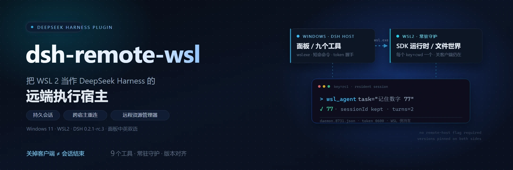
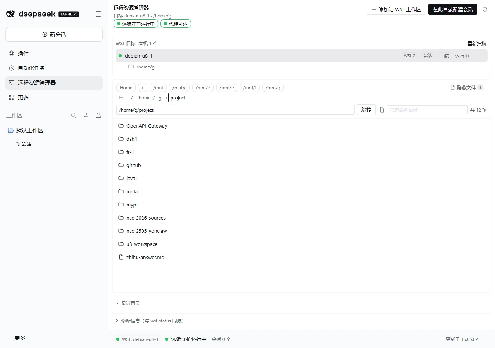
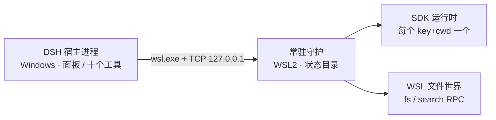
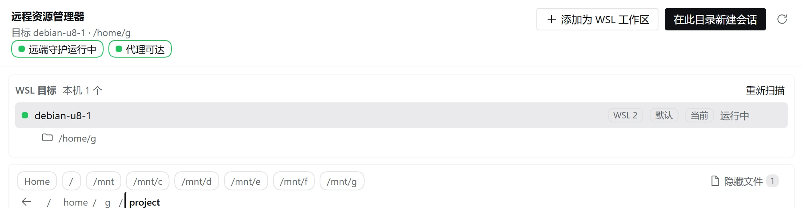
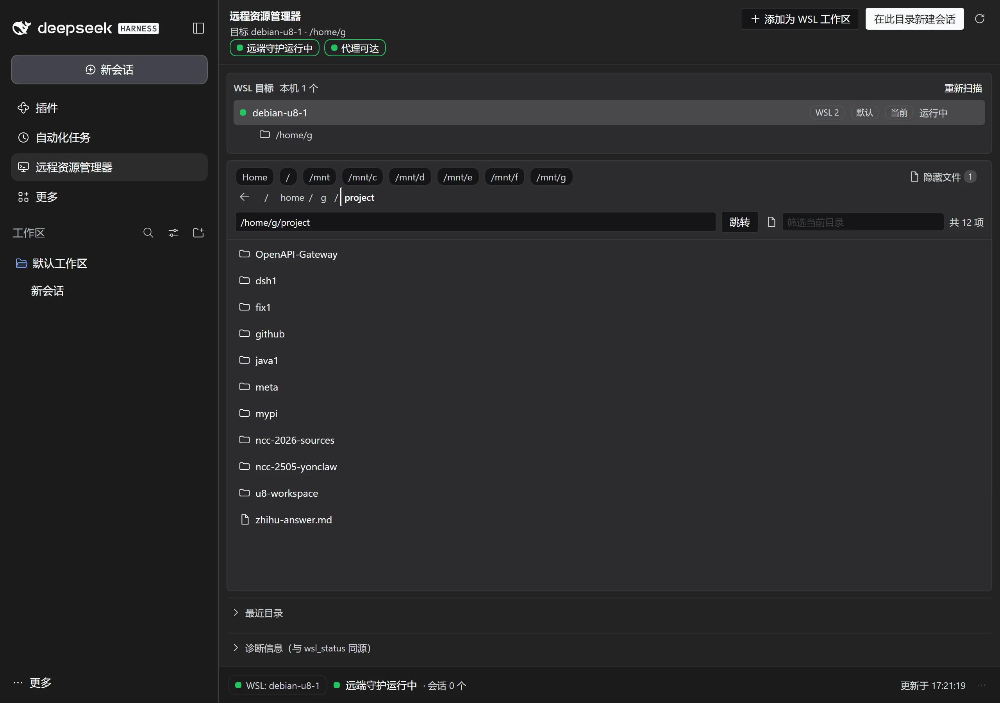
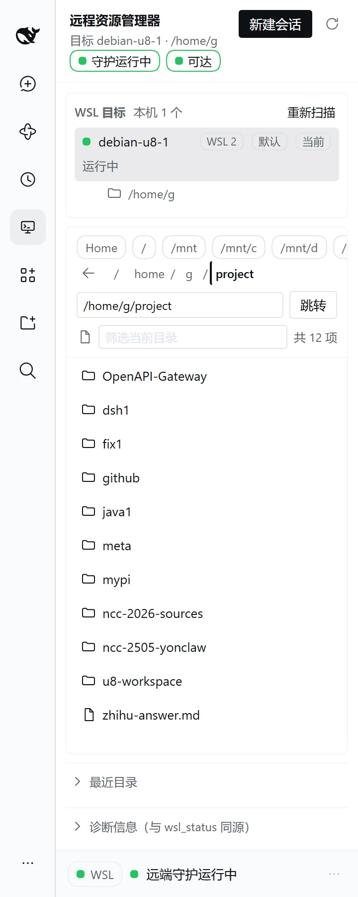

# dsh-remote-wsl



> 把 WSL 2 发行版当作 DeepSeek Harness 的**远端执行宿主**。
>
> 常驻守护让「关掉客户端 ≠ 会话结束」；换一个宿主进程，用同一个 `key` 还能接上之前的上下文。

[](https://www.npmjs.com/package/dsh-remote-wsl)
[](https://www.npmjs.com/package/dsh-remote-wsl)
[](https://nodejs.org)
[](LICENSE)
[](https://github.com/mozhuanzuojing/dsh-remote-wsl)
[](https://github.com/mozhuanzuojing/dsh-remote-wsl)
[](https://github.com/mozhuanzuojing/dsh-remote-wsl)

当前版本 **0.12.2** · 开发依据 DSH **0.2.2-rc.5** · Windows 11 + WSL2 实测 | 面板中英双语 | 只支持 WSL2 | 支持 npm 安装（0.12.0+）或 `link:` 装进 profile



**它是什么**：DSH 桌面壳的 host 由本机启动，没有「连远端 host」的开关（实测与机制见 [docs/2026-10-10-wsl-dsh-sdk-bridge.md](docs/2026-10-10-wsl-dsh-sdk-bridge.md)）。这个插件不假装有——它从 Windows 宿主侧驱动 WSL 里那份 dsh，提供九个工具、一个「WSL 工作区」面板，以及一个把文件工具搬进 WSL 的 agent preset，并把会话持久性、版本一致性和关停边界一起管起来。

## 30 秒上手

1. **装**：profile 的 `package.json` 用 `link:` 加依赖，再把 `dsh-remote-wsl` 加进 `dsh.profile.bundles`（完整步骤见[安装](#安装)）。
2. **验**：重启 DSH 后先调 `wsl_status`——只读、廉价，会报发行版、桌面版本、WSL pin、漂移和守护状态。
3. **用**：`wsl_exec` 跑一次性命令；`wsl_agent` 把任务交给 WSL 里常驻的 dsh（**关客户端 ≠ 会话结束**）。
4. **收**：`wsl_daemon action=stop` 显式结束；不显式停则由 `daemonIdleMs`（默认 30 分钟）回收 ⇒ 上下文丢失。

```text
# 第一个宿主进程（在 DSH 里说）
调 wsl_agent，key=rc1，task="记住数字 77，只回 ACK"

# 完全退出 DSH Desktop，再重新打开（新的宿主进程）
调 wsl_agent，key=rc1，task="刚才让你记的数字？只回数字"
# ⇒ 77 · 同一 sessionId / runtimePid · turns=2
```

前置（简版）：WSL2 发行版，WSL 侧有 `mise` + `pnpm` + Node ≥ 26.10；凭据用 WSL 自己的 `~/.dsh/.credentials.yaml`，**不要复制 Windows 的 key**。完整清单见[前置条件](#前置条件)。

## 它怎么工作



- 默认 `daemon` 后端下，守护的元数据、token 与运行日志都在 WSL 侧（preset 注册诊断 `startup.log` 在 Windows 侧）；Windows 侧不持有 agent 运行时，只发短命命令、按 token 握手，或为 `wsl_open_ui` 挂一个 web host。
- 运行时由守护持有，所以宿主进程退出不会带走会话。
- 版本 pin 在 WSL 侧；桌面升级后用 `wsl_sync_version` 显式对齐。

## 功能

- **常驻会话**：`wsl_agent` 的运行时由 WSL 侧守护持有。关掉 DSH 客户端，会话不会结束；再开一个宿主进程，用同一个 `key` 和同一个 `cwd` 还能接上之前的上下文。回复会带 `sessionId` / `runtimePid` / `turns`。
- **会话结束只有三种方式**：显式 `wsl_daemon action=stop`（`restart` 也会先结束）；空闲 `daemonIdleMs`（默认 30 分钟）回收；守护或运行时死亡。守护在无 key 且无客户端持续 `daemonLingerMs`（默认 10 分钟）后自退，有会话时不会触发。
- **同 key 串行**：并发 prompt 在守护里 FIFO；超过 `daemonQueueLimit`（默认 4）明确拒绝，不静默排队——上游 SDK 没有 cancel。
- **十个工具**：诊断、一次性命令、常驻 agent、守护生命周期、远程 UI、版本对齐、路径互转、WSL 内 grep/glob，详见下方表格。
- **WSL 工作区**：左侧栏「插件」下的面板。
  - **入口位置（2026-11-18）**：已移除左下角 footer 的 `WSL` 按钮（及其「添加 WSL 工作区」弹窗）；同一面板改为注册为**会话 View 标签**，出现在会话顶部标签栏、「统计」右侧（`conversation.view`，order 50）。添加工作区仍用面板头部的「添加为 WSL 工作区」把当前浏览目录登记为工作区。
  - **紧凑文件表（2026-10-30）**：文件行显示名称、大小、修改时间（目录不显示大小）；窄态隐藏时间列；单发行版时隐藏重复的 WSL 目标大卡，减少顶部噪声。
  - **WSL 目标**：发行版列表（状态点 + 默认/当前徽标 + WSL 版本），点行内「切换」换目标；切换只影响本面板的请求，不改插件配置。WSL1 行标「仅支持 WSL2」，面板的 host 方法会拒绝。
  - **目录浏览**：路径框 / 面包屑 / Home / 最近目录，支持隐藏文件与筛选。
  - **守护状态**：头部药丸显示运行态，悬停提示里带 pid/版本/槽位；未运行时可直接点起。底栏显示会话数、更新时间和漂移。
  - **代理三态徽标**：可达 / 不可达（带 `host:port`）/ 未探测。数据取自既有 `snapshot.proxy`，不新增请求。
  - **在此目录新建会话**：浏览到配置 `cwd` 以外的目录时，主按钮是它——建一个真 DSH 会话（会话出现在左侧列表）；在配置 `cwd` 内主按钮是「添加为 WSL 工作区」。**2026-10-29 起默认落 WSL preset**：主流程 `addWorkspace → host explorer.newSession → uiWorkspace.openSession`，host 侧 `create({cwd|workspaceId, agentPreset:'wsl'})`，并把 `presetApplied` / `agentPreset` / `presetError` 作为**事实**回给面板（旧宿主不认 `agentPreset` 时面板如实说"未应用"，不谎称成功）。
  - **打开文件/目录**：文件行新增「打开」，通过 `explorer.openExternal` 在 VS Code 中打开；目录用 `--folder-uri`、文件用 `--file-uri`，URI 是 `vscode-remote://wsl+<distro><linuxPath>`（无 VS Code CLI 时给可操作错误；资源管理器候选 `\\wsl.localhost\...` / `\\wsl$\...` 由 host 侧 helper 生成）。
  - **添加为 WSL 工作区**：把目录登记成 UNC 工作区（该工作区的文件工具走 9P，和「远端会话」是两条路，见下方「已知边界」）。
  - **远端会话卡**：列出 `cwd + sessionId 前 8 位`、轮次与空闲时间，可复制完整 sessionId。
  - **窄态与双语**：320 / 360 / 376 / 416 / 420 / 480 / 1280 七档实测无横向溢出；窄态下快捷目录 chips 保持完整并横向滚动（不压字）；中文 / English 跟随宿主语言。
- **WSL 执行世界（实验）**：agent preset `wsl`，名称「WSL（远程执行世界）」。
  - **WSL 模式变体（2026-10-30）**：宿主 roster 中所有健康的基础 preset（`standard` / `ptc` / `code` / `minimal` / `cordis` 以及自定义项）都会生成 `wsl-<id>` 变体；显示名采用 `WSL · Standard mode（标准模式）` 形式（未知 id 回退为 `WSL · <id>`）。变体通过 `agentPresets.readDocument` + WSL world 替换 + `js-yaml` 重新解析注册；**含 `!!js` 表达式的源 preset 会明确失败**（变体暂不支持求值），失败只记日志，不影响原有 `wsl` preset。
  - 文件工具经 `{op:'fs'}` RPC 交给 WSL 侧守护用原生 `node:fs` 执行，**不走 9P**（绕开 `write` 在 `\\wsl.localhost\…` 上的原子写失败）。
  - `listDir` 的符号链接语义与上游 `dsh-fs-local` 一致：链接**跟随目标**（`ln -s /etc d` 报 `directory` 而不是 `other`），子项身份取 `realpath`（同一文件不会因不同链接得到两个身份）。
  - WSL 内 `grep` / `glob` 优先用 ripgrep / fd，没有再回落 ugrep / GNU grep / find。
  - **原生 `bash`（2026-10-29 起）**：preset 的 `wsl-world` 隔离组里把 `ctx.shell` 也换成了 WSL 执行器（`src/shell-provider.ts`），组内的 `bash` 工具**直接跑在发行版里**（每条命令一次 `wsl.exe`；`set -m` 独立进程组，超时/中止时按进程组回收，后台孤儿由脚本自己收；超上限**留尾部**并把全文落到 WSL `/tmp` 的 spill 文件）。它**不受 Windows 文件沙箱约束**：执行器 `sandboxMode` 返回 `undefined`，模型看到的 `sandbox_permissions` 参数不存在——这是事实，不是提权通道。**验证边界**：执行器层已真机验证（9 条）；「模型 → `bash` 工具 → WSL」的整链路需要重启 DSH 后人工验收（见 `docs/2026-10-29-native-shell.md` §6）。
  - **WSL 右侧栏终端（2026-10-30，host subprocess bridge）**：官方 Terminal 的 controller 读的是**宿主** `subprocess.spawnTerminal`，preset 内 `isolate: {subprocess:true}` 的 provider 覆盖不到它（实测仍起 `cmd.exe` 并因 UNC cwd 报错）。根插件因此在 `src/subprocess-bridge.ts` 里包装宿主 `spawnTerminal`：`cwd` 是 `\\\\wsl.localhost\\…` / `\\\\wsl$\\…` 时，解析出 `distro` 与 Linux 路径，改成 `wsl.exe -d <distro> --cd <path> --exec bash -l`；其它 cwd 原样放行。**边界**：终端标签仍显示 `cmd.exe`（shell 发现仍走宿主），以内容和 `uname` 为准；WSL preset + Windows 盘符 cwd 的会话不触发。
  - **标准 preset 的 UNC 文件桥（2026-10-29 检查修复，2026-11-05 扩展）**：即使没选 `wsl` preset，只要会话 cwd 是 `\\wsl.localhost\<配置发行版>\…`，`write` / `edit` / `patchText` / `deleteFile` / `moveFile` 也会由 `src/fs-unc-bridge.ts` 接到 WSL 侧 fs-rpc。原因是宿主 `dsh-fs-local` 在 9P 上替换已有文件时会调用 `GetFileSecurityW`/`ReplaceFileW` 复制 DACL，直接报 `GetFileSecurityW EIO (Win32 1)`。桥同时覆盖 `/mnt/...`（DrvFs）。自 2026-11-20 起，本发行版 UNC（**ext4 与 /mnt**）的 `resolve/lstat/stat/readText/streamText/readBytes/readByteRange/listDir` 与五个写方法**统一走 WSL fs-rpc**，版本基线统一为 **WSL 令牌**（同平面逐字 CAS，不再做宿主↔WSL 令牌翻译）。内容读在守护不可用（稳定错误码 `FS_DAEMON_UNAVAILABLE`）时**不再回退宿主 9P**：ext4 访问明确失败，并给出启动守护 / 诊断指引（决策 A）。其它 Windows 路径原样走宿主实现。
  - 18 个常用 Rust CLI（ripgrep、fd、ast-grep、sd、bat、tokei 等）的安装目录：核心 8 个在守护启动时后台预热（可用 `--no-provision` 关掉，测试/CI 用），`grep` / `glob` 缺 rg / fd 时按需装，任意项可用 `wsl_tools action=install` 装到 `~/.local/bin`。
  - **下载会校验 sha256，且校验结论是可见的**：`verified` 取 `ok`（官方摘要：GitHub API `digest` 或发布页校验文件）、`pinned`（只有内置 TOFU 摘要）、`unavailable`（上游没有任何摘要 ⇒ 本次没校验，会写进结果说明）、`mismatch`（不匹配 ⇒ **拒绝安装**）。内置摘要表覆盖 18 个兜底 URL，其中 5 项与官方来源逐字相等，其余 13 项该版本上游未发布摘要 ⇒ **TOFU pin**：只保证「与钉住的那一份一致」，不证明上游未被入侵，因此记 `pinned` 而不是 `ok`。
  - 文件工具按 host 的 `workspace-write` 策略做真实路径围栏（符号链接祖先也被解析后再判定，越界返回 `FS_SANDBOX_DENIED`）；`watch` 在 host 契约里没有入口，插件保留实现但不依赖它。
- **版本对齐**：桌面版本从 `primary-runtime/runtime.json` 读；WSL pin 落 `~/.dsh/.desktop-version-pin`。`wsl_status` 报漂移，`wsl_sync_version` 修复，`backgroundWarm` 负责后台预热。守护不会因版本不一致被自动杀掉——要换版本走显式 `wsl_daemon action=restart`。
- **路径互转**：`wsl_path` 只做字符串转换，不创建目录、不改文件；路径走 argv 位置参数，含空格/引号/`$(...)` 也保持字面量。
- **主题**：跟随 DSH 的浅色 / 深色（面板只读宿主 CSS 变量，不写死颜色）。

### 界面



深色（跟随 DSH 主题）：



窄态（窗口 360；快捷目录 chips 横向滚动，完整显示、不再压字）：



### 十个工具

| 工具 | 做什么 |
|---|---|
| `wsl_status` | 只读诊断（传 `redetect: true` 时会**重探一次**并可能更新目标）：发行版、桌面 dsh 版本、WSL pin、漂移、dlx 已装版本、shell 环境开关、`localhostForwarding`、守护 pid/端口/版本/keys、实际 `identity`（distro/user/home/platform/arch）与 `wsl exec` 命令通道健康度（timeout 时会明确提示 WSL VM 可能卡住、建议 `wsl --shutdown`，且插件不会自动杀守护） |
| `wsl_exec` | 在 WSL 里跑一次性 bash（cwd 是 Linux 路径），回 exit/stdout/stderr；默认 120s，脚本带 `set -uo pipefail`（管道读端早退时 SIGPIPE 会如实表现为 `exit 141`）；危险命令（删除/格式化/容器销毁/Git 破坏性清理/重启等）执行前需宿主审批，无审批通道时拒绝 |
| `wsl_agent` | 把任务交给 WSL 里的 dsh（`--profile sdk`，stdio JSON-RPC）；守护持有运行时，支持 `followUps`、`key`、`cwd`；**其内部生成的命令不经过 `wsl_exec` 的危险命令门禁** |
| `wsl_daemon` | `status` / `start`（幂等）/ `stop`（显式结束会话，`all=true` 清孤儿）/ `restart`（对齐新版本） |
| `wsl_open_ui` | 在 WSL 里起 `dsh web`，在 Windows 开应用窗口；`stop=true` 停掉 |
| `wsl_sync_version` | 读桌面版本 → 比对 WSL pin → 可选预热 → 修复 pin；`warm=true` 物化该版本 |
| `wsl_path` | 包一层发行版的 `wslpath`：`D:\...` ⇄ `/mnt/d/...`；`direction` 可选 `to-wsl` / `to-windows` / `both` |
| `wsl_grep` | **在发行版里** grep：一帧 `{op:'search'}` 由守护扫完整棵树（不走 `\\wsl.localhost` 的 9P、不 spawn Windows ripgrep）。标准 preset 的会话里遇到 WSL 路径就用它代替 `grep` |
| `wsl_glob` | 同上，列出发行版内匹配 glob 的文件（`fd`/`find`，一次 RPC） |
| `wsl_doctor` | 只读体检：把本插件自带探针（平台/发行版/目标/DSH 版本/漂移/守护/内存·swap/配置告警）聚合成 verdict（ready / degraded / blocked）+ 逐项 check + 修复命令；不启动发行版、不启停守护、不写盘 |

## 安装

### 前置条件

- **Windows 10/11 + WSL2**。WSL1 不支持：目标行会标灰，面板的 host 方法会拒绝（7 个工具本身不做 WSL1 检查）。
- **WSL 侧 `mise` + `pnpm` + Node ≥ 26.10**。插件用 `mise exec -- pnpm dlx @deepseek-ai/dsh@<pin> --profile sdk` 拉取对应版本（实际还带 `--allow-build=...`），不要求全局装 `dsh`；首次需要网络/代理。
- **推荐启用 systemd**：`/etc/wsl.conf` 里 `[boot] systemd=true`。systemd 主路径无窗口、且守护独立于 Windows 侧；不可用时走兼容回退，可能弹出可见控制台窗口（插件会在返回值/`notes` 里告警）。
- **WSL 侧凭据**：`~/.dsh/.credentials.yaml`。WSL 与 Windows 是两份独立的 `~/.dsh`，**不要复制任何 key**。
- 代理：`proxyPort` 默认 `9910`。插件先探测再使用；不用代理也可以，探测失败只会显示「不可达 / 未探测」，不阻断直连。

### 从 npm 安装（0.12.1+）

```powershell
# 1) 让 profile 依赖到 npm 版本（不要再用 link:）
#    %USERPROFILE%\.dsh\profiles\<profile>\package.json
"dependencies": { "dsh-remote-wsl": "^0.12.1" }

# 2) 把包名追加到 dsh.profile.bundles 末尾（同上文件），再重启 DSH
```

> 为什么包要自带 `lib/*.js`：Node 的类型擦除**拒绝 `node_modules` 里的 `.ts`**
> （`ERR_UNSUPPORTED_NODE_MODULES_TYPE_STRIPPING`）。`link:` 装的是工作树路径，所以 `src/*.ts` 能跑；
> 从 npm 装文件落进 `node_modules/`，宿主半与 WSL 侧守护半都会拒绝加载 —— 因此 `main`/`exports`/
> 守护脚本一律指向构建产物 `lib/*.js`（`npm run build` 产出，`npm run check:pack` 逐条真加载验证）。

### 装进 profile（源码方式 / 开发用）

仓库必须放在 **Windows 能访问的路径**（host 半在 Windows 跑，WSL 侧会经 `/mnt/<盘符>` 读同一份源码）：

```powershell
git clone https://github.com/mozhuanzuojing/dsh-remote-wsl.git D:\tools\dsh-remote-wsl
```

在 `%USERPROFILE%\.dsh\profiles\<profile>\package.json` 里改两处（**保留原有条目**）：

```json
"dsh-remote-wsl": "link:D:/tools/dsh-remote-wsl"
```

```json
"dsh-remote-wsl"
```

第一处加进 `dependencies`；第二处追加到 `dsh.profile.bundles` 末尾。以本机 `desktop` profile 为例，形如：

```json
{
  "dependencies": {
    "dsh-remote-wsl": "link:D:/tools/dsh-remote-wsl"
  },
  "dsh": {
    "profile": {
      "bundles": ["@deepseek-ai/dsh-base", "@deepseek-ai/dsh-web-app", "dsh-remote-wsl"]
    }
  }
}
```

> 实际使用时应保留你 profile 里已有的 base / web-app 等 bundle，不要只留这三项。

`link:` 依赖需要由 package manager **物化**成 profile 里的 `node_modules` 链接（profile 的 `node_modules/.pnpm/lock.yaml` 会记下这条 link）。所以正确顺序是：

1. 重启 DSH Desktop，让宿主在启动时把 profile 依赖装好；
2. 确认链接真的建出来了：`Get-Item "$env:USERPROFILE\.dsh\profiles\desktop\node_modules\dsh-remote-wsl"` 应指向你 clone 的目录；
3. 只有第 2 步仍不存在时，才手工补一个等价的 junction 兜底：

```powershell
$repo = 'D:\tools\dsh-remote-wsl'
$link = "$env:USERPROFILE\.dsh\profiles\desktop\node_modules\dsh-remote-wsl"
if (-not (Test-Path $link)) {
  New-Item -ItemType Junction -Path $link -Target $repo | Out-Null
}
```

重启后新开会话，让 agent 调一次 `wsl_status`：返回里应有 `plugin: dsh-remote-wsl@<version>`、发行版、版本与守护状态；左侧栏「插件」下应出现「WSL 工作区」。

**装不上时按这个顺序查**（桌面 GUI 看不到 stderr，插件加载失败不会弹窗）：

- `<profile>/node_modules/dsh-remote-wsl` 是否存在并指向仓库 —— `link:` 没被物化是第一位原因；
- 宿主启动日志里的 `skippedBundles` / 插件加载错误 —— bundle 行包名写错时插件**根本不会加载**；
- 再重启一次 DSH（host 半改动必须重启；只有 client 改动：`npm run build` 后刷新页面）；
- 不要用 `dsh --profile desktop --dump-config` 验证：`desktop` profile 由 Electron 独占，CLI 会直接拒绝（`profile "desktop" is managed exclusively by the Electron application`）。

### 升级 / 回滚 / 卸载

**版本 = 提交**：`git -C D:\tools\dsh-remote-wsl rev-parse --short HEAD`；运行时 `wsl_status` 会打印
`plugin: dsh-remote-wsl@<package.json 版本>`（自 0.1.1 起）。出问题时先记下这两个值，否则无法定位到改动。

升级：

```powershell
git -C D:\tools\dsh-remote-wsl pull --ff-only
# 重启 DSH Desktop（host 半代码在启动时加载；client 改动：`npm run build` 后刷新页面）
```

回滚到任意提交（`link:` 安装意味着工作树就是运行中的代码）：

```powershell
git -C D:\tools\dsh-remote-wsl checkout <commit>
# 重启 DSH Desktop
```

卸载：

1. 先结束远端会话（可选，避免留下运行中的守护）：`wsl_daemon action=stop all=true`；
2. 从 profile 的 `package.json` 里删掉 `dsh-remote-wsl` 依赖与 `dsh.profile.bundles` 中的那一行；
3. 删掉 `node_modules\dsh-remote-wsl` 链接/junction，重启 DSH；
4. 可选清理 WSL 侧状态目录 `<wslHome>/.dsh/remote-wsl`（元数据/日志）与 `/tmp/dsh-rwsl-*` 残留。


### 配置

**默认就是零配置**：`distro` / `wslHome` / `cwd` 的默认值都是空 = **自动探测**（0.3.3 起；旧版本默认写死作者机器的 `debian-u8-1` / `/home/g`，换机器就报「未知发行版」）：

1. `distro` ← `wsl -l -v` 里 NAME 列带 `*` 的**默认发行版**（没有 `*` 行就留空，**不会**拿"唯一那个"猜）；
2. `wslHome` ← 该发行版登录用户的 `$HOME`（`wsl -d <distro> --exec sh -c 'printf %s "$HOME"'`，`sh` 不行再试 `bash`）；
3. `cwd` ← 跟随 `wslHome`。

探测只在**没有显式配置**时发生（一次 `wsl -l -v` + 一次 `$HOME`，实测本机 ~156ms；两次各有 8s / 10s 上限 —— WSL 卡死时启动最多多等 18s，不会无限挂）。结论（**成功与失败都**）按进程缓存：改 `wsl --set-default`、或修好 WSL 之后，默认要**重启 DSH** 才会重新探测（也可以直接显式配置跳过探测）。

> **0.3.5：探测失败可以在会话内救回来（A-P2-E）**：如果 DSH 启动那一刻 WSL 冷启动/卡住导致首次探测失败，不必重启 DSH —— 调用
> `wsl_status({ redetect: true })` 会清掉进程内缓存、按**显式配置原值**重探一次，并**原地**写回配置（`wsl_exec` / `wsl_agent` / 面板立即生效）。
> 显式配置的 `distro` / `wslHome` / `cwd` 永远不被覆盖。**边界（如实说）**：`wsl` agent preset 的文件/搜索子插件拿的是注册时的配置快照，
> 它们仍要重启 DSH 才会跟随；普通 `wsl_status` 调用**不会**触发重探（保持只读/廉价），只在失败时输出提示。
> 注意第 2 步在发行版**未运行**时会被 WSL 拉起（WSL 自身行为：任何 `wsl -d` 都会）—— 想连这一步都避免，就显式配置。

显式配置**永远优先**（此时一个 `wsl.exe` 都不会起）。要显式指定，先查本机的值：

```powershell
wsl -l -q
$distro = 'Ubuntu-24.04'   # 换成 wsl -l -q 里的名字
wsl -d $distro --exec bash -lc 'echo $HOME'
```

然后写进 `%USERPROFILE%\.dsh\profiles\desktop\cordis.patch.yml`（保留该文件已有内容）：
```yaml
- id: remote-wsl
  config:
    distro: Ubuntu-24.04   # wsl -l -q 里的名字
    wslHome: /home/you     # 发行版里的 $HOME
    cwd: /home/you
    dshVersion: ''         # 空 = 跟随桌面版本
```

探测失败时**不猜、不回落到作者机器的值**：工具会直接返回可操作报错，`wsl_status` 也会把它标成 `target ⚠️: remote-wsl: 未能自动探测到 WSL 默认发行版…请在 cordis.patch.yml 里显式配置 distro`。

> **0.3.3 升级提示（`cwd`）**：显式配了 `wslHome`、但没配 `cwd` 的用户，有效 cwd 现在**跟随 `wslHome`**（旧版固定 `/home/g`）。若旧守护报告的 cwd 与新的不同，会被判为结构性不兼容 ⇒ 需要 `wsl_daemon action=restart` 一次（该动作会丢当前会话上下文）。显式写上 `cwd` 可保持原样。

> **0.3.4 升级提示（`provider` / `model`）**：守护现在会在 `meta` / `hello` / `status` 三处上报**实际生效的** `provider` / `model`，宿主复用守护前会核对：不一致 ⇒ 结构性不兼容、明确要求 `wsl_daemon action=restart`（不再静默沿用旧 provider —— 那正是上一轮"配置改了像没改 / 401"的根因）。**旧守护（0.3.4 之前）不上报这两个字段** ⇒ 宿主只能给 soft 提示（`daemon route: ⚠️ 守护没有上报实际 provider/model`），restart 一次后即可核对。`wsl_daemon status` / `wsl_status` 里的 `provider=` / `model=` 是"实际在跑的那一个"，不要凭配置文件推断。协议版本随之到 **v3**。

常用配置键：

| 键 | 默认 | 作用 |
|---|---|---|
| `distro` / `wslHome` / `cwd` | 空 = **自动探测** | 目标发行版、WSL 家目录、远端 agent 的默认工作目录 |
| `provider` / `model` | `deepseek-official` / `deepseek-flash` | 远端 agent 用的 provider 与模型 id（以 WSL 侧 dsh 的 provider catalog 为准，例如 `commandcode` + `deepseek/deepseek-v4.1-flash-fast`）。**守护是常驻进程：改完必须 `wsl_daemon action=restart` 才生效**；0.3.4 起复用前会核对，不一致直接报错并提示 restart |
| `profile` | `sdk` | WSL 侧 dsh 的 profile（守护据此装载插件集）。变更同样需要 `wsl_daemon action=restart` |
| `backend` | `daemon` | `daemon` = 运行时由 WSL 常驻守护持有；`in-host` = 旧形态逃生舱（关客户端即丢会话） |
| `commandPolicy` | `standard` | `standard` = `wsl_exec` / WSL preset `bash` 的危险命令需宿主审批；`off` 只能由操作者显式关闭，Agent 不可改 |
| `daemonPort` | `8731` | 守护槽位/端口；WSL 侧被占则 +1，Windows 侧被占则换端口重试 |
| `daemonIdleMs` | `1800000` | 空闲回收，到期即丢上下文 |
| `daemonLingerMs` | `600000` | 无 key 且无客户端时的自退闸门；有会话不触发 |
| `daemonQueueLimit` | `4` | 同 key 并发 prompt 的等待位上限，超出明确拒绝 |
| `useShellEnvironment` | `true` | 把 WSL 登录 shell 环境注入**常驻进程**（`wsl_agent` 的守护后端 / `wsl_open_ui` / in-host）；一次性 `wsl_exec` 不注入。改了它需要 `wsl_daemon action=restart` 才对已运行的守护生效 |
| `backgroundWarm` | `true` | 版本漂移时后台预热，不阻塞当前调用 |
| `webPort` | `3082` | `wsl_open_ui` 在 WSL 里起的 web 端口 |
| `proxyPort` | `9910` | 宿主代理探测端口 |
| `shellTimeoutMs` / `shellMaxTimeoutMs` | `120000` / `600000` | WSL preset 里原生 `bash` 的单条命令默认超时 / 上限（模型可用 `timeoutMs` 覆盖，超上限按上限夹紧） |
| `shellMaxOutputBytes` | `65536` | 原生 `bash` 每条流保留的字节上限；超出丢弃并标 `truncated`（本轮**不落 spill 文件**） |
| `shellGraceMs` | `3000` | 原生 `bash` 被 kill 时 SIGTERM → SIGKILL 的宽限 |
| `dshVersion` | `''` | 空 = 跟随桌面；也可钉死某个版本 |

## 使用

| 想做什么 | 怎么做 |
|---|---|
| 看发行版 / 版本 / 漂移 / 守护 | `wsl_status` |
| 启动时目标探测失败（WSL 没就绪） | `wsl_status({ redetect: true })` 会话内重探一次（不用重启 DSH；`wsl` 预设子插件仍需重启才跟随） |
| 跑一条一次性命令 | `wsl_exec`（`command`、`cwd`、`timeoutSec`） |
| 跑长任务 / 后台任务 | 用 `wsl_exec` 时不要依赖普通 `&` 或裸 `setsid`；用 `nohup ... > /tmp/x.log 2>&1 < /dev/null &`、`setsid -f ...` 或 `systemd-run --user --collect ...` 并把日志写文件（2026-10-30 实测普通 `&` 会在包装层退出后被回收） |
| 让 WSL 里的 agent 做多轮 | `wsl_agent`（`task`、`followUps`、`key`、`cwd`） |
| 关掉客户端后继续 | 同上；重新打开后保持 `key` 与 `cwd` |
| 结束远端会话 | `wsl_daemon action=stop`（或 `restart` 换版本） |
| 打开 WSL 里的 Web UI | `wsl_open_ui`（`port` 默认 3082，`open=false` 只起服务） |
| 桌面升级后对齐版本 | `wsl_sync_version`（可 `warm=true`）→ `wsl_daemon action=restart` |
| Windows / WSL 路径互转 | `wsl_path`（`direction=both` 默认） |
| 浏览 / 打开 WSL 目录 | 左侧栏「WSL 工作区」 |

这些工具是给模型用的：你直接在会话里描述任务，或显式点名工具；下面的例子是显式写法。

### 持久任务

```text
调 wsl_agent，key=release，task="检查 /home/you/project 的构建，失败就修到通过"
```

关闭客户端不会结束它。下次在同一个 profile / 同一份 daemon 配置下（同一个 `daemonPort`），用同一个 `key=release` 和同一个 `cwd` 继续；换了 `cwd` 会开新会话（守护按 `key+cwd` 分运行时）。要立刻结束用 `wsl_daemon action=stop`。

### 一次性命令

```text
调 wsl_exec，command="git -C /home/you/project status --porcelain"
```

超时默认 120 秒；脚本按 `set -uo pipefail` 执行。管道读端早退（如 `yes | head -1`）得到 `exit 141` 是 bash 语义，不是插件失败。

### 远程 UI

```text
调 wsl_open_ui，port=3082
```

它在 WSL 里起 `dsh web`，并用带 token 的 URL 开一个 Windows 应用窗口。桌面壳本身仍然不能连远端 host，这是补位而不是等价替换。

### WSL 执行世界

新建会话时把 preset 选成「WSL（远程执行世界）」，**文件工具与 `bash` 都落到配置的发行版里**（`bash` 走 `src/shell-provider.ts`：每条命令一次 `wsl.exe`、独立进程组、超时/中止按组回收；终端 PTY 仍是宿主工具）；`wsl_tools` 可以列/装这些 WSL 侧 CLI 工具。面板里「在此目录新建会话」默认就落这个 preset。想跑一次性体检仍可用 `wsl_exec`，要跨宿主持久会话用 `wsl_agent`。

#### 世界路由（v0.12.0+）

cwd 落在 WSL 里的**空白会话**（`source=startup` 且 header 里还没有 preset）会自动落到 WSL 世界：
优先 `wsl-<默认模式>` 变体，其次 `wsl`。规则很短，但**越界的口子一个不留**：`resume`/`clear`/`compact`
不动、用户显式选过的 preset 一律不覆盖、别的发行版的 cwd 不碰、宿主没注册 WSL 预设就明确放过。
关掉它：`worldRoute: false`。

为什么要有它：宿主平面（standard preset）在 UNC 工作区里只有一条补丁通路（`fs-unc-bridge`），
`grep`/`glob` 仍是宿主自带的 Windows ripgrep 走 9P —— 守护侧"一次扫完一棵树"的 `{op:'search'}`
对这类会话**根本没接线**（实测守护 RPC 增量 = 0）。落进 WSL 世界后，同样的 grep 变成 1 次 RPC。
对不能改世界的会话（用户显式选了别的 preset），逃生口是 `wsl_grep` / `wsl_glob`。

#### 传输层：长连接复用 + 批量帧（协议 v5，v0.12.0+）

旧实现**每个 op 一条 TCP 连接**。实测一次文件密集回合能到 1106 次 RPC / 8.3 秒（峰值 165/s），
而 Windows 每个关闭的连接会占本地临时端口约 120 秒（默认 `TcpTimedWaitDelay`），本机动态端口范围
只有 16384 个（49152–65535）—— 持续 130+/s 两分钟就把池子打光，之后**全机**新建连接都会拿到
`EADDRINUSE`（WinError 10048）。用户看到的那条 `connect EADDRINUSE 127.0.0.1:8731` 就是这么来的：
**不是目的端口被占，是本机临时端口没了**；而 `wsl_daemon status` 只做一次握手，自然是"正常"的。

v5 的两条改动：

- **长连接复用**：`fs`/`search`/`status` 走池化连接（一连接多请求、按 `id` 配对、空闲 45s 关闭、
  超时/断开即重连）。旧守护本来就支持一条连接多帧 ⇒ **池化对旧守护也能用**。
- **批量帧**：同一 tick 内的多条**只读** fs 调用合成一帧 `{op:'fs', method:'batch'}`（上限 64 条，
  逐条独立成败；写操作永不进批）。旧守护回 `unknown fs method: batch` ⇒ 该连接标记 `batchUnsupported`
  并逐条退回单发（不重试、不慌报成功）。

隔离守护实测（Windows→WSL，同样的 300 次 `fs.stat`）：

| 路径 | 连接数 | 耗时 |
|---|---|---|
| 旧（每 op 一条连接） | 300 | 622ms |
| 池化 | 1 | 127ms |
| 池化 + 批量（60 条/帧） | 1 | 14ms |

诊断开关：`DSH_RWSL_FS_POOL=0` 退回短连接、`DSH_RWSL_FS_BATCH=0` 只池化不批量。

## 数据存在哪里

- **Windows 侧配置**：`%USERPROFILE%\.dsh\profiles\<profile>\package.json` 与 `cordis.patch.yml`。
- **Windows 侧诊断**：`%USERPROFILE%\.dsh\remote-wsl\startup.log`（preset 注册 / 启动诊断，宿主侧写入）。
- **WSL 侧状态目录**：`$wslHome/.dsh/remote-wsl/`
  - `daemon.<slot>.json` / `daemon.<slot>.token`（0600，按槽位分文件）
  - `daemon.log`、`launch-stderr.log`、`launch.<slot>.sh`（一次性启动脚本，正常启动后清理）
- **面板最近目录**：浏览器 `localStorage['dsh-remote-wsl.recent']`（按发行版分组，最多 8 条）。
- **WSL 版本 pin**：`$wslHome/.dsh/.desktop-version-pin`。
- **凭据**：WSL 的 `~/.dsh/.credentials.yaml`。Windows 的 `%USERPROFILE%\.dsh` 与它是两份独立副本，**不要跨侧复制**。
- **插件版本**：`wsl_status` 打印 `plugin: dsh-remote-wsl@<version>`；准确版本以提交为准（`git rev-parse --short HEAD`）。
- `wsl_open_ui` 的 access token 由工具回复返回；不要把它写进仓库或公开日志。
- **验证产物不入库**（0.1.1 起）：历史上的 `spike/`（探针原始输出、pid/log/token、截图）已从版本库移出，
  只保留在作者本机；可重跑的回归用例改放在 `test/`（见「开发」）。

## 兼容性

- **DSH**：最低要求 **`>=0.2.2-rc.5`**（本机在 DSH 0.2.2-rc.5 上运行；0.12.2 起下限抬到实测版本）。宿主真正执行的兼容门是 **`engines.dsh`**（`>=0.2.2-rc.5`；
  rc 语义按 semver 实算，过期不会导致静默禁用）；`dsh.compatibility.dshReleases` 只是**声明**、宿主不校验。
- **平台**：Windows + WSL2；macOS / Linux 不适用，WSL1 不支持。
- **WSL 侧运行时**：Node ≥ 26.10（实测 26.10.0）、pnpm（实测 12.6.0）、mise（实测 2026.9.7）。Windows 侧使用 DSH 自带运行时。
- **systemd**：推荐启用；不启用时走兼容回退，可能弹出可见控制台窗口。
- **面板**：中文 / English 跟随宿主语言；320–1280 七档无横向溢出。
- **分发**：npm 包（`main` / `exports` 指向 `lib/*.js` 构建产物）；也可按 `link:` 装进 profile。**发布前必须先 `npm run build`**，否则 `lib/` 缺失会让安装形态加载失败（`npm run check:pack` 就是拦这个的）。

## 已知边界（不假装有）

- **没有命令沙箱**：`wsl_exec` / `wsl_agent` 的命令跑在**你自己的 WSL** 里，不受 Windows 侧 DSH 文件策略约束。要隔离请用 WSL 侧手段。
- **危险命令门禁（2026-10-30 起）**：`wsl_exec` 与 WSL preset 内的 `bash` 会在执行前识别删除、磁盘格式化、容器销毁、部署销毁、Git 破坏性清理、重启/关机等命令，并通过 DSH 宿主审批通道请求操作者确认；无审批通道时**拒绝执行**（fail-closed），不会自动放行。`wsl_agent` 是 WSL 内的完整 dsh agent，其生成的命令**不经过**这层门禁；不要把 `wsl_agent` 当成受沙箱保护的执行通道。
- **桌面壳不能连远端 host**：`wsl_open_ui` 是补位，不是把桌面壳改成远端连接。
- **SDK 没有 cancel、没有 per-prompt 结果**：放弃一轮 = 结束运行时 = 丢上下文；同 key 并发只能 FIFO + 上限拒绝。
- **守护退出后的文件恢复**：WSL preset / standard preset UNC 桥共享的 fs provider 在守护元数据缺失或连接被拒/提前关闭时，会清掉 `daemonReady`、重新 `ensureDaemon` 并只重试一次；`timeout` / `error`（含 ECONNRESET）不重发，避免有副作用操作重放。
- **超时不会自动重试**：`wsl_agent` 超时（默认 600s）后**不会**自动重发同一个 prompt —— 请求可能已送达并在守护里继续执行，重发会让有副作用的操作跑两遍。先确认远端是否已产生效果，再决定是否重试。守护"半死"（端口可连但不应答）也不会自动重启，用 `wsl_daemon action=restart`。
- **升级后旧守护会继续活着**：守护是 detached 的，宿主升级/重启都不会杀它。`wsl_status` 会显示守护的插件/协议版本；版本不一致时新功能（流式读取、`listDir` 的符号链接语义、**0.2.2 的 `patchText`/`deleteFile`/`moveFile`**、安装校验结论等）在 `wsl_daemon action=restart` 前不可用（状态里会明确告警）。本版协议为 **v4**（在 v3 的守护身份字段之上新增 `fs.patchText` / `fs.deleteFile` / `fs.moveFile` 三个 op），属加法：新宿主仍可复用旧守护，只是新 op 在 restart 前不可用。
- **9P / UNC 上的文件工具**：standard preset 的 `write` / `edit` / `patchText` / `deleteFile` / `moveFile` 已由 `src/fs-unc-bridge.ts` 接管到 WSL fs-rpc；`/mnt/...` 路径的 `resolve` / `stat` / 读取类方法也由同一桥接入（Windows 9P 对 DrvFs 会 EPERM）。但用 Windows 的 `git` / `pnpm` 等写型工具改 WSL 里的 ext4 文件，仍可能写坏属主/权限；跑工具或改文件请走 `wsl_exec` / `wsl_agent`，或用 WSL 执行世界的文件工具。跨 OS 文件事件不可靠，插件不监听。
- **WSL 执行世界只服务配置的一个发行版**；面板可以浏览多个发行版，但文件世界不会跟着切。
- **`watch` 目前没有消费方**：DSH 0.2.2 的 `FileSystem` 契约里 `watch` 是可选的（基类直接拒绝），插件里保留了 500ms 轮询实现但宿主不会调用；跨 OS 文件事件本就不支持，别依赖它。
- **自动装工具依赖网络**：从 GitHub Releases 选包，限流时走固定地址兜底；下载后校验 sha256 并**把结论说出来**（`ok`/`pinned`/`unavailable`，不匹配直接拒绝安装）。`unavailable` 表示"上游没给摘要、本次没校验"，不要当成已验证。失败会把原因和手动安装命令附在结果里，不静默降级。
- **版本兼容有两条线**：宿主只看 `engines.dsh`（不满足会拒绝加载，并在 `skippedBundles` / 启动日志里留痕）；
  `dsh.compatibility.dshReleases` 只是给人看的声明，宿主不读。

## 和同类 WSL 插件怎么选

- 要**一次性命令 / 发行版体检 / 侧栏终端**，`dsh-wsl-tool` 一类更直接；要**关客户端不丢的持久会话 + 跨宿主重连**，用本插件。两套名字不冲突（本插件是 `snake_case`），可以并存。
- `dsh-wsl-workspace` / `dsh-plugin-wsl-env` 把 WSL 当**工作区 / 执行环境**；本插件把 WSL 当**远端运行时宿主**。路线互补，不是替代。
- 路径转换两边都有：本插件是 `wsl_path`，`dsh-wsl-tool` 是 `wsl-path`。

## 开发

**构建**：`npm run build` 做两件事 —— ① 把 `src/client/*.ts` 用 `esbuild` 打成单文件 `lib/client.js`；② 把 host 半（`src/` 除 client）用 `tsc -p tsconfig.build.json`（`--noCheck` + `rewriteRelativeImportExtensions`，只转译并把 `./x.ts` 改写成 `./x.js`）转译成 `lib/*.js`。产物**随包入库**，也是 npm 安装形态的唯一入口（`main`/`exports` 全指向 `lib/`）。改 `src/` 后要么 `npm run build`、要么另开一个 `npm run dev`（`tsc --watch`）——**因为 `main`/`exports` 已经指向 `lib/`，宿主不会再直接读 `src/*.ts`**；发布前必须 build：Node 拒绝 `node_modules` 里的 `.ts`，`npm run check:pack` 会把 tarball 解开、逐个 entry 真加载来拦这件事。`src/client/*.ts` 有 tsc 类型检查（`npm run typecheck`），`npm run check` 做零依赖语法校验；无 `@deepseek-ai/*` 运行时依赖。Windows 侧用 DSH 自带 Node 跑 `.ts`（实测 24.21.0）；WSL 侧守护按 `engines.node` 需要 ≥ 26.10。

| 路径 | 作用 |
|---|---|
| `src/index.ts` | 插件入口：注册十个工具 / 面板数据面 / preset（默认值已收敛到 `src/config.ts`） |
| `src/config.ts` | **唯一一份**默认配置 + `normalizeConfig()` + 目标可用性判据（`targetProblem()`） |
| `src/target-detect.ts` | 零配置目标探测：`wsl -l -v` 的默认发行版 + 它的 `$HOME`（纯函数 + 注入式 probe） |
| `src/distro-table.ts` | `wsl -l -v` 表解析（面板与探测共用一份） |
| `src/register-tools.ts` | 十个工具的实现 |
| `src/tool-catalog.ts` | **工具清单唯一真相源**：banner / README 的"N 个工具"与工具表都由它推导（门禁双向校验） |
| `scripts/banner.ts` | banner 生成器：按事实产出 `assets/banner.svg`；`--render` 光栅化成 `assets/banner.webp`；`--check` 是漂移门禁 |
| `assets/banner.svg` | banner 母版（**脚本生成，别手改位图**） |
| `src/daemon.ts`、`src/daemon-*.ts` | WSL 侧常驻守护、协议、launcher 与生命周期 |
| `src/explorer.ts` | 面板数据面 `POST /remote-wsl/api`（同源 + 硬白名单） |
| `src/open-editor.ts` | VS Code Remote-WSL URI 与资源管理器 UNC 候选纯函数 |
| `src/fs-provider.ts`、`src/fs-rpc.ts` | WSL 执行世界的 fs provider 与 RPC |
| `src/fs-unc-bridge.ts` | standard preset 的 UNC 文件桥：写/编辑/patchText/deleteFile/moveFile + `/mnt` 解析与读取，绕过 9P DACL/DrvFs 限制 |
| `src/preset.ts`、`src/search-tool.ts` | `wsl` preset、WSL 内 `grep` / `glob` 与 `wsl_tools` |
| `src/shell-provider.ts` | WSL preset 里的 `ctx.shell` 替代实现（原生 `bash`：cwd 翻译 / 输出上限 / 超时 / 进程组回收） |
| `src/client/` | client 半源码（TS；含 i18n 与全部 CSS） |
| `lib/client.js` | client 构建产物（esbuild，`npm run build`，随包入库） |
| `lib/*.js` | host 半构建产物（`tsc -p tsconfig.build.json`，随包入库；npm 安装形态的入口） |
| `test/` | 可重跑的回归用例（Node 内置 test runner，直接跑 `.ts`） |
| `scripts/check-syntax.ts` | 零依赖语法门禁（`src` 用 Node type stripping 解析、`client` 用 `node --check`） |
| `assets/` | README 配图：banner、宽态 / 深色 / 窄态 / 头部截图 |
| `docs/` | 契约、设计、评审与先例调研 |
| `spike/verify/` | 作者本机的历史探针与原始输出（**0.1.1 起不入库**，别在别处引用） |

常用命令（Node ≥ 22.6；本机用 DSH 自带 Node 或 WSL 里的 node 均可）：

```powershell
# 语法门禁 + 回归测试（零依赖，不需要 npm install）
node --experimental-strip-types scripts/check-syntax.ts
node --experimental-strip-types --test test/*.test.ts

# 重新生成 banner（改工具数 / DSH 版本后必跑；需要 ego-browser + Pillow）
npm run banner

# 契约门禁（方法表 host≡client、bundle 同步、i18n 中英逐键相等/无重复、静态 t() 键可达、工具清单≡注册≡README 表）
node --experimental-strip-types scripts/check-contract.ts

# 一次性跑完全部门禁（语法 + 契约 + 类型 + 测试）
npm run verify

# 真实 WSL /mnt 读桥探针（可复现；会启动守护，需 WSL 侧可用）
node --experimental-strip-types scripts/probe-unc-bridge.ts "\\\\wsl.localhost\\debian-u8-1\\mnt\\d\\path\\to\\file"

# 装上 pre-push 钩子（可选：有配置 GitHub 代理时，推送前会探测代理可达性）
npm run hooks
```

`test/` 里除纯函数回归外还有**守护生命周期集成测试**（`test/daemon-integration.test.ts`）：
它用 `process.execPath` 把 `src/daemon.ts` 当子进程拉起（**不能 import** —— 那是可执行脚本），
配 `bind(0)` 的空闲端口与 `os.tmpdir()` 下隔离的 `--state-dir`，真验 hello/token、错误 token 拒绝、
首帧非 hello 拒绝、超大帧拒绝后仍存活、`status`、SIGTERM 清理、二次 SIGTERM、非法参数 fail-fast、
`shutdown` op。用 `--no-provision` 保证**零网络**确定性；跑完不留状态目录、不留守护进程。
Windows 上没有可捕获的 POSIX 信号，所以两条信号用例会**显式 skip**（原因写在输出里），
回收路径由 `shutdown` 那条跨平台覆盖。

守护链路自检（status 不会启动守护；未运行时以非 0 退出是正常的）：

```powershell
$node = "$env:LOCALAPPDATA\Programs\DeepSeek Harness\resources\runtime\primary-runtime\dependencies\node\bin\node.exe"

& $node src/selftest.ts status

# 跨进程重连：每次 prompt 都是新进程，同一个 key 仍复用同一运行时
& $node src/selftest.ts prompt rc1 "记住数字 77，只回 ACK"
& $node src/selftest.ts prompt rc1 "刚才的数字？只回数字"
& $node src/selftest.ts stop
```

 > **改 client 的硬规则**：改 `src/client/*.ts` 后必须 `npm run build` 重建 `lib/client.js`（平台按 `lib/client.js` 的 rev 决定浏览器缓存；不重建则仍吃旧产物）节）。

设计取舍：

- **运行时放守护**：宿主可来可走，跨进程/跨宿主复用上下文；代价是空闲回收与显式生命周期。
- **不引 `@deepseek-ai/*` 依赖**：`link:` 安装拿不到依赖，所有服务经 `ctx.get` / `ctx.inject` 读取。
- **脚本落文件再执行**：`pwsh → wsl.exe → bash` 多层会吃引号，base64 内联又会占 stdin；写成 WSL 侧文件两者都躲开。
- **版本 pin 显式**：桌面版本与 WSL 侧不一致时只报警、不自动杀守护，换版本必须显式重启。
- **文件世界走 RPC 而不是 9P**：9P 不支持宿主默认 provider 的原子写；WSL 侧 `node:fs` 才能保留 POSIX 语义。

验证与设计记录：[docs/](docs/)（契约、面板规格、评审）、[GAP-AUDIT.md](GAP-AUDIT.md)（与 VS Code Remote-WSL 的差距核实）、[docs/2026-10-27-fix-round-3.md](docs/2026-10-27-fix-round-3.md)（v0.3.0：供应链校验接线、F-50/F-32/F-33、listDir 符号链接、守护 EPIPE/死代码、集成测试）、[spike/verify/](spike/verify/)（每轮探针与 REPORT）。

## 更新日志与许可

- **0.12.2（2026-11-25）兼容口径对齐**：`engines.dsh` 由 `>=0.2.2-rc.2` 抬到 **`>=0.2.2-rc.5`**（下限取实测版本；`engines.dsh` 是宿主唯一真正校验的字段，`dsh.compatibility.dshReleases` 宿主不读）；README 兼容性一节同步。此前 0.4.0–0.12.1 各版未在此表逐条记录，逐版历史以 [tag](https://github.com/mozhuanzuojing/dsh-remote-wsl/tags) 为准，本表自 0.12.2 起恢复维护。
- **0.3.20（2026-11-05）适配 DSH 0.2.2-rc.1**：`list_agents` 已并入 `dsh-tool-subagent-control` 主包（原 `/list-agents` 子路径被上游删除，保留会让整份 WSL preset 判为 broken）；`dsh-tool-subagent` 的 `modelSelectionSettings` 改名 `modelSelection` + `modelDiscovery`；补齐 0.2.2 的 `fs.patchText` / `fs.deleteFile` / `fs.moveFile`（WSL fs provider + UNC 桥，守护协议 v4），编辑/补丁改为 CRLF 规范化后匹配并按原行尾写回；`tool-fs` 仍按上游标准默认 `applyPatch: false`；内置 preset 的 plan-mode 提示与 0.2.2 标准 preset 对齐。根因、对照与验证证据：[docs/2026-11-05-dsh-0.2.2-adaptation.md](docs/2026-11-05-dsh-0.2.2-adaptation.md)
- [提交历史](https://github.com/mozhuanzuojing/dsh-remote-wsl/commits/main)
- [设计 / 验证记录](docs/)
- MIT © 2026 磨砖做镜 (mozhuanzuojing)

## WSL git 路由范围（v0.5.0+）

- 仅把 `workspace-changes` 的 git **快照**调用（`add` / `write-tree` / `ls-files` / `diff-tree` / `cat-file` 等）在 WSL 工作区里重写进发行版（`wsl.exe --exec git …`）；**discovery** 调用（`--show-toplevel` / `--absolute-git-dir` / `--git-path`）仍用宿主 git（WSL 共享需要 `safe.directory`）。
- 因此"变更审查更快、不再受 9P 拖慢"成立；但 **Windows 侧没有 git 时 discovery 仍会失败**（本版未覆盖 sentinel + stdout 回译）。
- host `subprocess.spawn` 不可用时 git 路由不生效（启动日志会出现 `[diag] git-route: skipped …`）。
- 文件读/列（`readText/streamText/readBytes/readByteRange/listDir`）与 `stat/lstat/resolve`：ext4 也**改走 WSL 守护原生**（免宿主 9P）；守护不可用时 **fail-closed**（`FS_DAEMON_UNAVAILABLE` + `wsl_daemon start`/`wsl_doctor` 指引），不回退宿主 9P（决策 A）。面板 `explorer.listDir` 的 ext4 分支要求**守护已在跑**（面板不主动拉起守护；未起时错误块直接给「启动守护」入口，成功后自动重试列目录；守护动作超时 120s，其它读动作仍 9s）。标准 preset 的 ext4 文件读/stat 因此**依赖守护**（用户已确认的取舍）。

## 诊断：`wsl_doctor`（只读，v0.6.0+；面板入口 v0.9.0+）

一次调用聚合本插件自带探针（平台 / 发行版 / 目标 / DSH 版本 / 版本漂移 / 守护 / **WSL 内存·swap** / 配置告警）为
**verdict（就绪 / 可用有警告 / 被阻塞）+ 逐项 check + 修复命令**。排障先跑它，别猜。

- **模型侧**：调用工具 `wsl_doctor`（或直接说「诊断一下 WSL」）。
- **面板侧**：`⋯` →「诊断」→「运行只读诊断」（`explorer.diagnose`）：一句话结论（verdict + 阻塞/警告计数），
  完整报告进折叠区。

**只读承诺（结构保证，不是口头约定）**：诊断路径**不启动发行版、不启动/停止守护、不写盘**——
WSL 内事实走 UNC 读 `/proc/meminfo`（**没有 `wsl -d`**，所以停着的发行版不会被拉起），
守护事实只读元数据文件；探针失败一律落成 `skip`/`fail`（`skip ≠ ok`，UI 单独列「未探测」）。
工具与面板共用 `src/doctor-facts.ts` 的同一份事实，保证两侧 verdict 一致。

